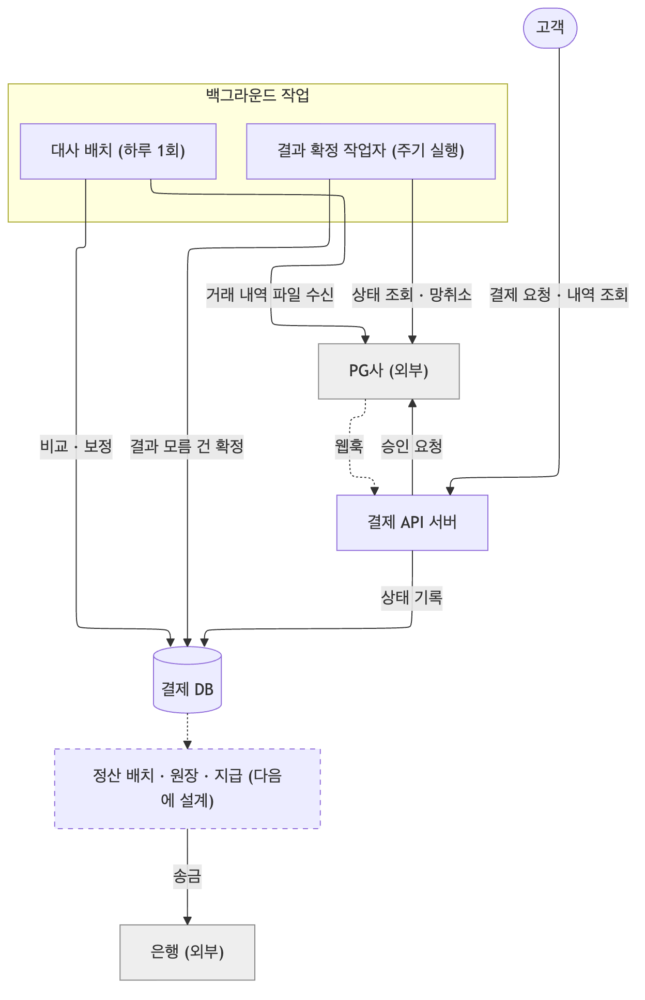
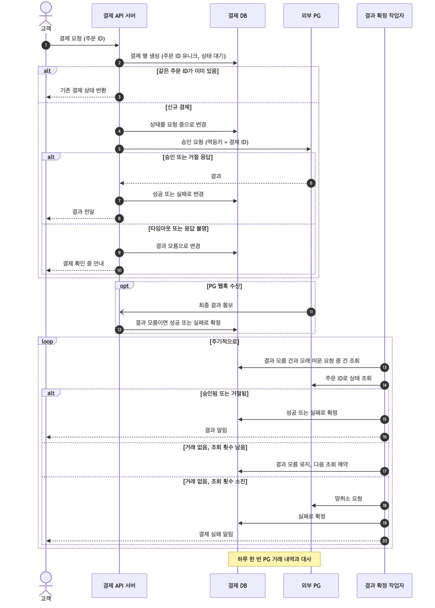
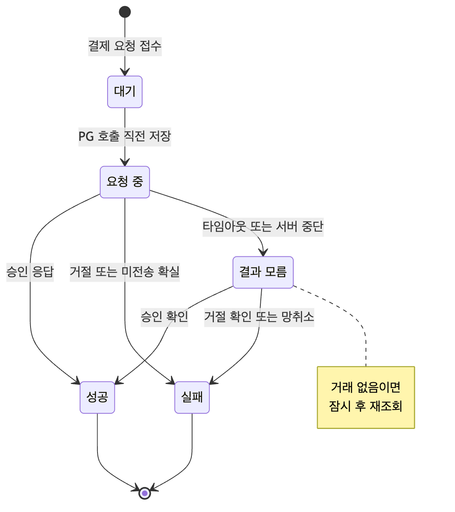

## 1주차 숙제

## 자신의 첫 설계 그림 업로드

## 내가 선택한 기술과 그 이유 2~3개 작성

1. 멱등성 (중복 결제 방지)
   - 버튼을 여러 번 눌러도 결제가 한 건만 생기도록 DB 유니크 제약으로 막는다. 앱에서 "조회 후 저장"하면 동시 요청이 둘 다 통과할 수 있다.
   - PG 재요청은 멱등키로 한 번만 승인되게 한다. 멱등키가 없으면 재요청 대신 조회로 결과를 확정한다.

2. 상태 저장 + 트랜잭션 분리 (유실·장애 대응)
   - PG 호출은 DB 트랜잭션으로 묶을 수 없다. 롤백해도 PG 승인은 취소되지 않고, 응답을 기다리는 동안 DB 연결만 붙잡는다.
   - 그래서 "요청 중" 커밋 → PG 호출 → 결과 커밋으로 나눴다. 중간에 서버가 죽어도 "요청 중"으로 남은 건을 찾아 PG에 조회해 확정한다.
   - 타임아웃은 "결과 모름"으로 두고 웹훅, 주기 조회, 망취소, 일일 대사로 확정한다.

3. 카프카 미사용 (규모)
   - 처음엔 유실 방지를 위해 카프카와 아웃박스 패턴이 필요하다고 생각했다.
   - 하루 100만 건은 초당 약 12건, 피크를 10배로 잡아도 약 120건이라 DB 한 대로 충분하다. 카프카를 넣으면 DB와 카프카 두 곳에 써야 해서 오히려 불일치 지점이 생긴다.

## 설계하면서 해결하지 못했던 질문 2개 작성

1. 실패 후 재결제는 허용하면서 중복 결제는 어떻게 막을까?
   - 주문 ID에 유니크를 걸면 재결제까지 막힌다. "진행 중이거나 성공한 결제는 주문당 하나"를 DB에서 어떻게 보장할지 모르겠다.

2. PG에서는 승인됐는데 우리 DB는 아직 "요청 중"이면, 고객에게 무엇을 보여줘야 할까?
   - 고객은 카드사 승인 알림을 먼저 받는데, 우리 화면은 "확인 중"이거나 서버가 죽었다면 오류로 보인다.
   - 데이터는 작업자 조회와 일일 대사로 결국 맞춰지지만, 대사는 하루 뒤라 그 사이 고객이 다시 결제하거나 문의할 수 있다. 확정 전에는 "확인 중"으로 보여 주고 내역 조회 시 바로 PG에 물어보는 방법을 생각했지만, 어디까지 해야 할지는 정하지 못했다.
