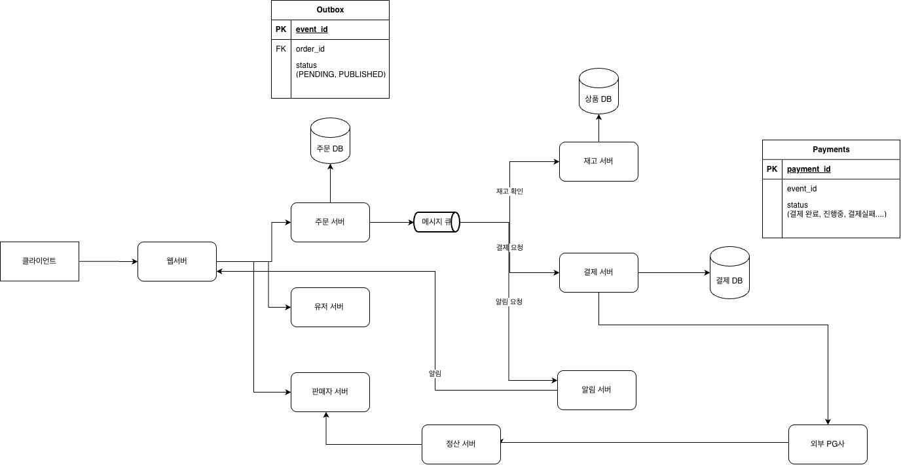

## 1주차 숙제

## 자신의 첫 설계 그림 업로드

## 내가 선택한 기술과 그 이유 2~3개 작성

1. 메시지 큐
   - 주문 서버가 재고 서버, 결제 서버, 알림 서버를 하나하나 직접 부르면 너무 엮일 것 같았다. 그래서 주문 들어오면 큐에 던져두고 각 서버가 알아서 가져가게 했다.
   - 중간에 서버 하나가 죽어도 메시지는 큐에 남아 있으니까 다시 살아나면 처리하면 되겠다고 생각했다.

2. 아웃박스 패턴
   - 주문은 DB에 저장됐는데 큐에 보내는 게 실패하면 결제 요청 자체가 사라진다. 이건 좀 위험하다고 봤다.
   - 그래서 주문 저장할 때 Outbox 테이블에도 `PENDING`으로 같이 넣고, 따로 읽어서 큐에 보낸 다음 `PUBLISHED`로 바꾸는 식으로 그렸다.

3. 결제 상태 저장
   - Payments 테이블에 결제 상태(결제 완료, 진행 중, 결제 실패...)랑 `event_id`를 같이 남겼다.
   - 같은 이벤트가 두 번 들어오면 `event_id`로 이미 처리한 건지 볼 수 있을 것 같았다. 진행 중으로 오래 멈춰 있는 건은 PG에 다시 물어봐서 정리하면 되지 않을까 싶다.

## 설계하면서 해결하지 못했던 질문 2개 작성

1. 결제를 큐 뒤에 두는 게 맞나?
   - 다 그리고 나서 보니 결제가 큐를 타면 고객은 버튼 누르고 결과를 바로 못 받는다. 알림 서버로 결과를 보내게 그리긴 했는데, 결제 결과는 그 자리에서 바로 보여줘야 할 것 같다.
   - PG 승인까지는 바로 처리하고, 정산이나 알림만 큐로 빼는 게 맞는 건지 아직 헷갈린다.

2. 하루 100만 건인데 큐에 아웃박스까지 필요할까?
   - 계산해보니 초당 12건 정도고 피크를 10배로 잡아도 120건이다. DB 하나로도 버틸 수 있을 것 같은 숫자다.
   - 큐랑 아웃박스를 넣으면 중복 메시지, 순서, 재발행 같은 것까지 챙겨야 한다. 이 규모에서 그만큼 복잡해질 가치가 있는지는 잘 모르겠다.
